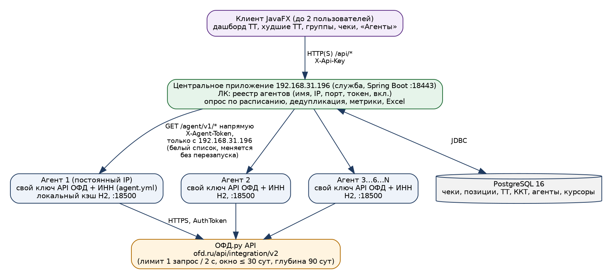

# Техническое задание на разработку системы «Сбор и анализ чеков ОФД.ру с маркировкой» (центральное приложение и агенты)

**Заказчик:** ИП Малахов Е.В. (ИНН 635001808204)
**Версия документа:** 2.0 (редакция 2), 25.11.2026 — изменена архитектура: сбор данных из ОФД.ру выполняют агенты на RDP клиентов, центральное приложение опрашивает агентов; в редакции 2 учтены ответы заказчика на открытые вопросы (раздел 18.1)
**Предыдущая версия:** 1.1 от 24.11.2026 (сохранена как TZ_v1.1.md.bak / ТЗ_v1.1.docx.bak)
**Статус:** проект для согласования с заказчиком; базовая реализация v2.0 выполнена (Приложение А)

Пометка «Предложено:» означает функцию или решение, которые заказчик прямо не просил; их включение в объём работ согласуется отдельно. Пометка «Требует проверки» означает факт, который не подтверждён официальной документацией и должен быть проверен на демо-стенде или у поддержки ОФД.ру. Требования к аналитике (разделы 7.4–7.9) сохраняют нумерацию версии 1.1 (ФТ-2.x, ФТ-5.x … ФТ-8.x); новые требования обозначены ФТ-А (агент), ФТ-Ц (центральное приложение) и НФТ-Б (безопасность).

## 0. Что изменилось в версии 2.0

| № | Было (v1.1) | Стало (v2.0) | Основание |
|---|---|---|---|
| 1 | Одна серверная служба сама ходит в API ОФД.ру по одному ключу | На RDP каждого клиента ставится **агент**; он хранит свой ключ API ОФД и сам собирает чеки | Решение заказчика 25.11.2026 |
| 2 | Ключ API ОФД хранится на центральном сервере | Ключ хранится **только на агенте** (agent.yml); в центр не передаётся | То же |
| 3 | — | Все запросы инициирует центральное приложение: оно опрашивает агентов (сейчас 6, проектируется на N) | То же |
| 4 | — | Доступ к агенту — по IP, которые указываются в ЛК центрального приложения; агент принимает запросы только с IP центра и с верным токеном | То же |
| 5 | Одна организация (ИНН) | Несколько организаций: у каждого агента свои ИНН (один ключ может обслуживать несколько ИНН) | Следствие п. 1 |
| 6 | Роль сервера: сбор + расчёт + отчёты | Роль центрального приложения: сбор данных со всех агентов, хранение, расчёт и вывод статистики «как было ранее» | Решение заказчика |
| 7 | — | Агент ставится на Windows Server 2019 как обычная служба Windows **без Docker**: Java 21 и WinSW входят в установочный архив, установка — одним скриптом PowerShell | Ответ заказчика 25.11.2026 (редакция 2) |
| 8 | — | Центр обращается к агентам напрямую с адреса 192.168.31.196; адрес можно сменить на агенте без переустановки и перезапуска (скрипт Set-AgentAllowedIps.ps1 или правка agent.yml) | То же |

Требования к аналитике, отчётам, правилу маркировки и товарным группам из версии 1.1 сохраняются без изменений.

## 1. Назначение и цели

### 1.1. Назначение

Система предназначена для регулярного автоматического получения всех пробитых чеков по кассам (ККТ) клиентов заказчика из ОФД.ру, разделения их на чеки с маркировкой и без маркировки, расчёта доли чеков с маркировкой по каждой торговой точке (ТТ) и товарным группам и просмотра состава чеков. Сбор из ОФД.ру выполняют агенты, установленные на RDP-серверах клиентов; центральное приложение собирает данные со всех агентов и показывает статистику.

### 1.2. Цели

- Заменить ручную выгрузку данных из личного кабинета https://lk.ofd.ru/receipt/search.
- Регулярно собирать чеки по всем ККТ всех клиентов (около 150 ТТ, 1000–2000 чеков в сутки по сети) через агентов.
- Хранить ключи API ОФД только на стороне клиента (на его RDP) и не передавать их в центр.
- Считать процент чеков с маркировкой по каждой ТТ и по каждой маркируемой товарной группе.
- Показывать ТТ с самой низкой долей («плохие» ТТ — ниже 25 %, порог настраивается) и чеки с конкретными товарами.
- Показывать состояние каждого агента: на связи ли он, когда был последний успешный опрос, какие ошибки, насколько отстают данные.

### 1.3. Исходные данные заказчика (решения по версиям 1.0 и 2.0)

| № | Вопрос | Решение заказчика |
|---|---|---|
| 1 | Права в ЛКК и API KEY | Учётная запись с КЭП имеет полные права ко всем ККТ; заказчик готов выпустить API KEY |
| 2 | Объём | 1000–2000 чеков в сутки по всей сети (около 150 ТТ) |
| 3 | ФФД | Все ККТ работают на ФФД 1.2 |
| 4 | Маркируемые товарные группы | Бакалея; табак; никотинсодержащая и табакосодержащая продукция; пиво фасованное; пиво разливное; вода; молочная продукция; соки |
| 5 | Виды чеков | Учитываются все виды: приход, возврат прихода, расход, возврат расхода, чеки коррекции, БСО; вид чека хранится и доступен в фильтрах |
| 6 | Справочник ТТ | Адреса ТТ и привязка ККТ берутся из ОФД.ру (список касс, адрес и место расчётов); внешних списков из 1С или Excel нет |
| 7 | Глубина первичной загрузки | Максимальная — 90 дней |
| 8 | Размещение | Постоянная работа на сервере как служба Windows; одновременно не более 2 пользователей |
| 9 | СУБД | PostgreSQL |
| 10 | Matrix/Element, Zabbix | Отложено, перенесено в раздел 19 «Перспективное развитие (отложено)» |
| 11 | Номенклатура | Формируется из позиций чеков ОФД, не из 1С |
| 12 | Порог «плохой» ТТ | Доля чеков с маркировкой ниже 25 %; настраивается, по умолчанию 25 % |
| 13 | Язык разработки | Java |
| 14 | Архитектура сбора | Агент на RDP клиента собирает данные из ОФД и передаёт их центральному приложению; ключ API — в агенте; запросы идут от центрального приложения к агентам (6 агентов); доступ к агентам — по IP, указанным в ЛК приложения (решение 25.11.2026) |
| 15 | Роль центрального приложения | Сбор всех данных со всех агентов и вывод статистики, как в версии 1.1 |
| 16 | Сетевой доступ к агентам (ред. 2) | У RDP постоянные IP; центр обращается к агентам напрямую (без VPN и проброса портов) |
| 17 | IP центра (ред. 2) | Центр обращается к агентам с 192.168.31.196; должна быть возможность менять этот адрес |
| 18 | ОС RDP (ред. 2) | Windows Server 2019 Standard x64, 2 × Xeon E5-2680 v4, 24 ГБ ОЗУ; права администратора есть; Docker не используется |
| 19 | Ключи ОФД (ред. 2) | У каждого клиента свой ключ API ОФД: один ключ — один агент |

### 1.4. Целевая платформа

- **Центральное приложение:** сервер с адресом 192.168.31.196 (с него центр обращается к агентам) — Windows x64 как служба Windows или Linux с Docker; PostgreSQL 16+ на том же сервере. Порт API — 18443 (8080 на 192.168.31.196 занят мониторингом и не используется).
- **Агенты:** RDP-серверы клиентов — Windows Server 2019 Standard x64 (2 × Intel Xeon E5-2680 v4 @ 2.40 GHz, 24 ГБ ОЗУ), права администратора есть, постоянные IP. Docker не используется: агент — обычная служба Windows, Java 21 входит в установочный архив (отдельно ставить не нужно). Поддерживаются также Windows Server 2016/2022 и Windows 10/11 x64; Linux с Docker — запасной вариант. Сейчас 6 агентов, система рассчитана на произвольное число (N). Порт агента — 18500.
- **Рабочие места пользователей** (до 2 одновременно) — ПК с Windows x64, клиент JavaFX, доступ к центру по сети.

## 2. Термины и сокращения

| Термин | Значение |
|---|---|
| ОФД | Оператор фискальных данных; в документе — ОФД.ру (OFD.ru) |
| ЛКК | Личный кабинет клиента ОФД.ру, https://lk.ofd.ru |
| ККТ | Контрольно-кассовая техника (касса) |
| РНМ | Регистрационный номер ККТ (в API — KktRegId / KktRegNumber / RNM) |
| ФН | Фискальный накопитель |
| ФД | Фискальный документ (чек, чек коррекции, БСО и т. д.) |
| ФФД | Формат фискальных документов; у заказчика на всех ККТ — 1.2 |
| ТТ | Торговая точка заказчика; в приложении определяется по адресу и месту расчётов ККТ из ОФД.ру |
| КМ | Код маркировки (Data Matrix и др.) |
| GTIN | Код товара (14 цифр) в составе КМ |
| Товарная группа | Маркируемая группа товаров заказчика (бакалея, табак и т. д., раздел 1.3, п. 4) |
| API KEY / AuthToken | Ключ доступа к API ОФД.ру, выпускаемый в ЛКК |
| КЭП | Квалифицированная электронная подпись (в т. ч. на токене Рутокен / JaCarta, через КриптоПро) |
| ГИС МТ / ЧЗ | Государственная система маркировки «Честный знак» |
| Чек с маркировкой | Чек, в котором есть хотя бы одна позиция с кодом маркировки (правило — раздел 4.5) |
| Доля маркированных чеков | Количество чеков с маркировкой / общее количество учитываемых чеков за период × 100 % |
| «Плохая» ТТ | ТТ с долей маркированных чеков ниже порога (по умолчанию 25 %) |
| Агент | Служба на RDP клиента: хранит ключ API ОФД клиента, собирает чеки и ККТ из ОФД.ру, хранит их локально и отдаёт центральному приложению по HTTP |
| Центральное приложение (центр) | Серверная служба заказчика: реестр агентов, опрос агентов, БД PostgreSQL, расчёт метрик, REST API для клиента |
| ЛК приложения | Раздел администрирования центрального приложения (вкладка «Агенты» в клиенте), где регистрируются агенты: имя, IP или хост, порт, токен, признак «включён» |
| Токен агента | Общий секрет агента и центра (не короче 16 символов, рекомендуется 64 hex-символа); передаётся в заголовке X-Agent-Token |
| Белый список IP (allowlist) | Список IP-адресов или подсетей (CIDR), с которых агент принимает запросы; обычно — IP центра |
| seq / курсор | Монотонный номер записи чека в БД агента; центр хранит по каждому агенту последний забранный seq (курсор) и запрашивает только более новые записи |
| instanceId | Идентификатор локальной БД агента; меняется при пересоздании БД агента и служит сигналом центру перечитать данные |

## 3. Текущий процесс и причина изменения архитектуры

- Сейчас данные берутся вручную со страницы поиска чеков ЛКК https://lk.ofd.ru/receipt/search.
- Вход в ЛКК выполняется по КЭП на токене.
- При 150 ТТ ручная выгрузка и подсчёт процента чеков с маркировкой занимают много времени и неудобны; регулярность сбора не обеспечена.
- Нет сводного рейтинга ТТ по доле чеков с маркировкой, нет разреза по товарным группам и нет быстрого перехода от ТТ к конкретным чекам и товарам.
- Причина перехода на агентов: у каждого клиента свой ключ API ОФД (подтверждено заказчиком, раздел 18.1); ключ должен оставаться на RDP клиента и не храниться централизованно, а запросы к ОФД.ру — идти с машины клиента.

## 4. Результаты анализа источников данных (без изменений относительно v1.1)

В версии 2.0 к API ОФД.ру обращаются агенты; методы, авторизация (AuthToken), лимиты и правило маркировки — те же. Лимит частоты действует на каждый ключ, поэтому с несколькими агентами суммарная скорость сбора выше, чем у одной службы (требует проверки: лимит на ключ или на кассу).

### 4.1. Есть ли у ОФД.ру официальный API для клиентов

Да. ОФД.ру публикует официальную документацию «Программный интерфейс приложений (API) для работы с ИС OFD®». Актуальная версия на дату анализа — 1.75 от 19.11.2026:

- Веб-версия: https://ofd.ru/razrabotchikam/ofd
- PDF 1.75: https://static.ofd.ru/ofdru/api/ofd/1_75.pdf
- PDF 1.73 (предыдущая): https://static.ofd.ru/ofdru/api/ofd/1_73.pdf
- Устаревший документ «API 2.0 для ИС „Чеки и ККТ“», версия 3.03 от 23.04.2024: https://static.ofd.ru/ofdru/api/cheki_i_kkt/3_03.pdf. Согласно истории изменений документа 1.75, версия 1.0 объединила документы «Чеки и ККТ» и «Отчёты».

На странице помощи ОФД.ру указано, что API находятся в открытом доступе для клиентов, и перечислены API ОФД, «Отчёты», Ferma и др. (https://ofd.ru/help/techquestions/voprosy-po-usluge-ofd).

Протокол: HTTPS, ответы в JSON, кодировка UTF-8. Успешный ответ — HTTP 200 и `"Status": "Success"`. Базовый адрес методов — `https://ofd.ru/api/integration/v2/`. Часть методов раздела 3 документирована на хосте `https://lk.ofd.ru/api/integration/v2/`.

### 4.2. Авторизация

По документации (раздел 1 «Авторизация»):

- Ключ доступа (API KEY) создаётся в ЛКК: раздел «Настройки» → вкладка «Управление передачей данных» → заявка на доступ к API ОФД. После обработки заявки ключ появляется на вкладке «Ключи доступа к API ОФД». В описании модуля 1С тот же путь начинается с раздела «Профиль» (https://ofd.ru/razrabotchikam/1c-management). Точное название пункта меню — требует проверки в ЛКК заказчика.
- Ключ выдаётся на личный кабинет организации (пару ИНН + КПП). В таблице баланса организации документа 1.75 указано, что КПП не указывается для ИП.
- Доступ ключа можно ограничить конкретным списком касс. Ключ можно заблокировать при компрометации.
- Срок действия ключа — 1 год.
- Выпустить ключ может только пользователь с полными правами ко всем кассам в ЛКК.
- Ключ передаётся параметром запроса `AuthToken={Code}` прямо в URL. ОФД предупреждает, что из-за этого он может попасть в access-логи, историю браузера и системы аналитики.

**Вывод для КЭП.** Вход в ЛКК возможен по логину и паролю либо по КЭП (https://ofd.ru/help/services/lichnyy-kabinet-klienta). Поддерживаются КриптоПро, JaCarta и Рутокен (https://ofd.ru/blog/newproducts/obnovlenie-v-rabote-s-kep-v-lichnom-kabinete-klienta-ofdru). КЭП нужна только один раз: войти в ЛКК и оформить API KEY. Сами запросы API авторизуются строкой AuthToken, поэтому токен с КЭП во время работы приложения не нужен. По подтверждению заказчика учётная запись с КЭП имеет полные права ко всем ККТ, поэтому выпустить ключ можно; заказчик готов это сделать.

**Стоимость.** В документации и на страницах ОФД.ру отдельная плата за API не найдена. Услуга ОФД оплачивается за кассу по тарифу. Платный ли доступ к API, — требует проверки у ОФД.ру. Отчёты, которые заказываются через API, разделены по уровням доступа Standard / Premium / Extra; отчёт «Маркировка» (MarkerDocReport) относится к Premium (раздел 7.1.1).

### 4.3. Методы API, нужные для задачи (подтверждены документацией 1.75)

| № раздела | Назначение | Метод и URL | Ограничения из документации |
|---|---|---|---|
| 3.2 | Список касс со всеми атрибутами (РНМ, ЗН, ФН, ФФД, адрес, место расчётов, папка, модель, даты договора и ФН) | `GET https://ofd.ru/api/integration/v2/kkts?AuthToken={Code}&Address={FiscalAddress}` (Address — необязательный фильтр) | 1 запрос в секунду |
| 3.1 | Папки (группы) касс в ЛКК — можно использовать как группы ТТ | `GET https://ofd.ru/api/integration/v2/kktgroup/list?AuthToken={Code}` и `...?groupId={Id}&AuthToken={Code}` | 1 запрос в секунду |
| 3.3 | Адреса всех касс по токену (РНМ → адрес) | `GET https://lk.ofd.ru/api/integration/v2/kkt/address/list?AuthToken={Code}` | не указано |
| 3.4 | Сводка по ТТ (по адресу): количество чеков, сумма, мин/макс/средний чек | `GET https://lk.ofd.ru/api/integration/v2/kkt/receipt/summary?AuthToken={Code}&Address=...&From=...&To=...` | без дат — последние 24 часа |
| 2.10.1 | **Основной метод.** Список чеков по кассе с позициями, кодами маркировки и результатами проверки КМ | `GET https://ofd.ru/api/integration/v2/inn/{INN}/kkt/{RNM}/receipts-info?dateFrom={Date1}&dateTo={Date2}&AuthToken={Code}` | 1 запрос в 2 секунды; окно запроса не больше 30 дней, даты начала и конца не должны совпадать; данные доступны за период не более 90 дней |
| 2.10 | Список чеков по кассе с позициями (без явного блока ProductCode в описании) | `GET https://ofd.ru/api/integration/v2/inn/{INN}/kkt/{RNM}/receipts-with-fpd-short?dateFrom=...&dateTo=...&AuthToken={Code}` | 1 запрос в 0,5 секунды; окно не больше 30 дней; не более 90 дней; порядок чеков произвольный |
| 2.5 | Список чеков (только заголовки, без позиций) за период по кассе | `GET https://ofd.ru/api/integration/v2/inn/{INN}/kkt/{KKT}/receipts?dateFrom=...&dateTo=...&AuthToken={Code}` | 1 запрос в секунду; окно не больше 30 дней |
| 2.8 | Подробная информация по одному чеку (позиции, ProductCode, 1162, 2106, 2107 и др.) | `GET https://ofd.ru/api/integration/v2/inn/{INN}/kkt/{KKT}/receipt/{RawId}?AuthToken={Code}`; альтернатива — `.../zreport/{ShiftNumber}/receipt/{DocShiftNumber}?AuthToken={Code}` | по RawId — 1 запрос в 0,02 с; по смене и номеру — 1 запрос в 0,05 с |
| 2.11 | TLV / JSON-представление чека с исходными тегами | `GET https://ofd.ru/api/integration/v2/receipts/json-doc?KktAgreementId=...&DocNumber=...&CustomFnNumber=...&AuthToken={Code}` | не указано |
| 2.3 | Отчёты о закрытии смен по всем ККТ за период (контроль полноты) | `GET https://ofd.ru/api/integration/v2/inn/{INN}/zreports?dateFrom=...&dateTo=...&AuthToken={Code}` | 1 запрос в секунду; окно не больше 30 дней |
| 7.1–9.1 | Заказ и скачивание отчётов ЛКК (в т. ч. «Маркировка», Premium) | `POST https://ofd.ru/api/integration/v2/reports/create?AuthToken={Code}`, `GET .../reports/list`, `GET .../reports/download?Id=...` | уровень доступа отчёта; лимиты не указаны |

Общие правила обработки ошибок (раздел 2, добавлены в версии 1.73):

- HTTP 400 — ошибка параметров или диапазона дат; 403 — доступ запрещён; 404 — объект не найден; 429 — превышен лимит запросов (`"Code": "RateLimitExceeded"`).
- Заголовок Retry-After не передаётся.
- Повторять запрос имеет смысл только после 429 (с паузой) и при внутренней ошибке сервиса. При 400, 403 и 404 повтор бесполезен.

Демо-контур для разработки (раздел 6): `https://lk-demo.ofd.ru/api/` и `https://demo.ofd.ru/api/integration`. На странице помощи ОФД.ру указан демо-кабинет с логином demo@ofd.ru и паролем demo.

**Что не подтверждено документацией (требует проверки):**

- Пагинация в методах 2.5, 2.10 и 2.10.1 не описана. Неизвестно, есть ли ограничение на число чеков в одном ответе.
- По какому полю фильтруются dateFrom/dateTo — по времени чека на ККТ (DocDateTime) или по времени приёма в ОФД (CDateUtc). От этого зависит, как догружать опоздавшие чеки.
- Возвращает ли 2.10.1 все чеки кассы или только чеки с КМ. В примере ответа есть позиции и с пустым ProductCode, и с кодом Code_GS_1M; из названия метода это однозначно не следует.
- Действует ли лимит частоты на один ключ в целом или на метод для каждой кассы отдельно. В документации сказано, что лимит «задаётся отдельно для каждого метода».
- Принимает ли путь `inn/{INN}` 12-значный ИНН ИП. В разделе 2.8 сказано «ИНН юридического лица. Строка состоит из 10 цифр»; при этом в примере ответа 3.2 указан 12-значный INN.
- «Данные доступны за период не более 90 дней» для 2.10 и 2.10.1 — это глубина от текущей даты или максимальная длина периода. Для данных старше 90 дней предусмотреть резервный путь 2.5 + 2.8.


### 4.4. Альтернативные источники данных

| Вариант | Плюсы | Минусы | Вывод |
|---|---|---|---|
| A. API ОФД.ру (2.10.1, справочник 3.2) | Официальный и документированный; есть все чеки по всем ККТ, позиции, коды маркировки и результаты проверки КМ; не нужен токен КЭП во время работы; демо-стенд для разработки | Лимиты (1 запрос в 2 с для 2.10.1); окно до 30 дней; глубина 90 дней для подробных методов; ключ на 1 год; ключ в URL | **Принят как основной и единственный обязательный источник** |
| B. Заказ отчётов ЛКК через API (7.1, тип «Маркировка» MarkerDocReport, «Сверка» ReceiptReport) | Готовые агрегаты ОФД | «Маркировка» — уровень Premium (может требовать отдельного тарифа); формат файла и состав колонок нужно изучить; асинхронная генерация | Вспомогательный: для сверки и как запасной вариант |
| C. Ручная или автоматическая выгрузка из веб-интерфейса lk.ofd.ru (Excel/CSV) | Тот же набор данных, что видит пользователь | Есть ли выгрузка на странице поиска чеков и её формат — требует проверки; автоматизировать вход по КЭП в браузере ненадёжно: нужен вставленный токен, PIN, плагин КриптоПро; вёрстка может измениться | Не используется |
| D. Браузерная автоматизация lk.ofd.ru (Selenium/Playwright) с КЭП | Не требует API KEY | Хрупкость; зависимость от токена и плагина; риски безопасности (PIN КЭП в скрипте); возможное нарушение правил ЛКК | Не используется |
| E. ГИС МТ «Честный знак», True API (https://docs.crpt.ru/gismt/True_API/) | Официальные данные о выбытии КМ через ККТ; есть сведения о количестве выведенных из оборота товаров | Авторизация по УКЭП (нужен токен КЭП для получения токена ГИС МТ); видны только маркированные продажи — немаркированных чеков нет, поэтому процент от всех чеков не посчитать | Отложено (раздел 19) |
| F. Локальные данные: 1С, кассовое ПО, ПИот на мини-ПК ТТ | Данные доступны ещё до ОФД | Нужно собирать со 150 точек; форматы зависят от ПО; риск неполноты | Не используется: по решению заказчика номенклатура и справочник ТТ берутся из ОФД.ру |

### 4.5. Как достоверно определить «чек с маркировкой» (ФФД 1.2)

Все ККТ заказчика работают на ФФД 1.2, поэтому правило строится на тегах ФФД 1.2. В ответе метода 2.10.1 (и 2.8) каждая позиция чека (Items, тег 1059) содержит:

- **ProductCode** (тег 1163) — объект с одним из полей:
  - коды маркировки: `Code_GS_1M` (1305, GS1 для товара, подлежащего маркировке), `Code_KMK` (1306, короткий КМ), `Code_MI` (1307, КИЗ меха), `Code_EGAIS_2` (1308), `Code_EGAIS_3` (1309);
  - не коды маркировки: `Code_EAN_8` (1301), `Code_EAN_13` (1302), `Code_ITF_14` (1303), `Code_GS_1` (1304, GS1 для товара, **не** подлежащего маркировке);
  - форматы `Code_F_1`…`Code_F_6` (1320–1325).
- **SubjectType** (тег 1212, признак предмета расчёта): 31 — подакцизный товар с КМ («АТМ»), 33 — товар с КМ («ТМ»), 30 — подакцизный маркируемый **без** КМ («АТНМ»), 32 — маркируемый товар **без** КМ («ТНМ»).
- **ProductCheckResultDetails** (тег 2106) — результат проверки КМ по позиции: 0, 1, 3, 5, 7, 15, 16, 17, 19; 15 — [М+], проверка выполнена положительно, статус у ОИСМ корректен.
- На уровне чека: **ProductCheckResult** (тег 2107) — результаты проверки маркированных товаров.

**Правило классификации (обязательное):**

1. Позиция считается **маркированной**, если в ProductCode (тег 1163) есть непустое значение `Code_GS_1M`, `Code_KMK`, `Code_MI`, `Code_EGAIS_2` или `Code_EGAIS_3`, и/или SubjectType (тег 1212) ∈ {31, 33}.
2. Список кодов из пункта 1 вынести в настройки. Включать ли форматы `Code_F_1`…`Code_F_6` — требует проверки на реальных чеках заказчика.
3. Чек считается **чеком с маркировкой**, если в нём есть хотя бы одна маркированная позиция. Чек без маркированных позиций — **чек без маркировки**.
4. По решению заказчика в расчёт доли входят **все виды чеков**: приход (Income), возврат прихода (RefundIncome), расход (Expense), возврат расхода (RefundExpense), а также чеки коррекции (Tag 31) и БСО (Tag 4/41). Вид документа (Tag) и вид операции (OperationType) хранятся по каждому чеку; в отчётах можно отфильтровать любые виды.
5. Примечание: тег 1162 («Код товарной номенклатуры», в API — ProductNomenclature) использовался для КМ в ФФД 1.05/1.1. Так как все ККТ заказчика на ФФД 1.2, в правило он не входит; значение сохраняется в БД справочно.

Дополнительные показатели качества маркировки, которые считаются по тем же данным:

- позиции с SubjectType 30/32 — продажа маркируемого товара без КМ;
- позиции с отрицательным результатом проверки (ProductCheckResultDetails ∈ {1, 5, 7, 17}).

### 4.6. Определение товарной группы

Заказчик продаёт маркируемые товары групп: бакалея; табак; никотинсодержащая и табакосодержащая продукция; пиво фасованное; пиво разливное; вода; молочная продукция; соки. Номенклатура формируется из позиций чеков ОФД, без 1С.

В API ОФД.ру отдельного поля «товарная группа ГИС МТ» в позиции чека нет (по документации 1.75). Поэтому группа определяется в приложении через справочник товаров:

1. **Справочник товаров строится автоматически** из позиций загруженных чеков. Ключ товара — GTIN из КМ (14 цифр после идентификатора применения «01» в коде GS1), если КМ есть; иначе нормализованное наименование позиции. Если один и тот же товар (по наименованию) встречается и с КМ, и без, записи связываются.
2. **Группа назначается** в порядке приоритета:
   - ручное назначение пользователем в справочнике (высший приоритет);
   - правила по ключевым словам или шаблонам в наименовании (например «пиво», «сигарет», «вода», «молоко», «кефир», «сок»); правила редактируются в настройках, стартовый набор поставляется с приложением;
   - правила по GTIN (список или префиксы GTIN → группа), которые пользователь может пополнять;
   - признак подакцизности (SubjectType 31/30) используется как подсказка для групп «табак», «никотинсодержащая продукция», «пиво».
3. Товары без группы попадают в очередь «Не распределены» с числом продаж. Назначение группы применяется ко всем прошлым и будущим чекам: метрики пересчитываются.
4. Представление разливного пива в чеках (КМ кеги, дробное количество) — требует проверки на реальных чеках заказчика.
5. Немаркируемые товары относятся к группе «Прочее (немаркируемое)».

### 4.7. Рекомендуемый подход

1. Выпустить API KEY в ЛКК ОФД.ру: один раз войти по КЭП, оформить заявку, ограничить ключ кассами заказчика. Права для этого у учётной записи заказчика есть.
2. Справочник ККТ и ТТ строить из метода 3.2 (FiscalAddress — адрес, FiscalPlace — место расчётов, Path — папка ЛКК). ККТ с одинаковыми нормализованными адресом и местом расчётов объединяются в одну ТТ.
3. Чеки с позициями и КМ собирать методом 2.10.1 по каждой ККТ через единую очередь запросов с соблюдением лимита, с перекрытием окна для опоздавших чеков.
4. Хранить данные в PostgreSQL, метрики по ТТ, ККТ, товарным группам и видам чеков считать на сервере.
5. Сервер (служба Windows на Java) работает постоянно. Пользователи (до 2) работают в десктопном клиенте, который обращается к серверу по локальной сети.
6. Для сверки использовать метод 3.4 (число чеков по адресу) и 2.3 (отчёты о закрытии смен) — контроль полноты загрузки.

### 4.8. Оценка нагрузки и объёма данных

Исходные данные: 1000–2000 чеков в сутки по сети, около 150 ТТ. В среднем это примерно 7–13 чеков в сутки на ТТ. Среднее число позиций в чеке неизвестно; для оценки принято допущение 3–5 позиций, уточняется по первым загруженным данным.

| Показатель | Нижняя оценка | Верхняя оценка |
|---|---|---|
| Чеков в сутки | 1 000 | 2 000 |
| Чеков за 90 дней (первичная загрузка) | 90 000 | 180 000 |
| Чеков в год | 365 000 | 730 000 |
| Позиций в год (при 3–5 позициях в чеке) | ≈ 1,1 млн | ≈ 3,7 млн |
| Объём БД в год, включая сжатый исходный JSON и индексы | ≈ 2 ГБ | ≈ 6 ГБ |
| Объём БД без хранения исходного JSON | ≈ 1 ГБ | ≈ 2,5 ГБ |

Расчёт объёма: заголовок чека ≈ 0,5 КБ, сжатый JSON чека ≈ 2–4 КБ (хранение в TOAST PostgreSQL), позиция ≈ 0,3 КБ, индексы ≈ 30–50 % от данных. С учётом ежедневных резервных копий на диск закладывается не менее 20 ГБ на год работы.

Нагрузка на API ОФД.ру (лимит метода 2.10.1 — 1 запрос в 2 секунды):

- **Ежедневный сбор.** Один запрос на ККТ (окно «последние 3 суток» с перекрытием): ≈ 150 запросов × 2 с ≈ 5 минут; в одном ответе в среднем 20–40 чеков.
- **Сбор каждый час** (если понадобится) — те же ≈ 5 минут на каждый запуск, ≈ 3 600 запросов в сутки, что укладывается в лимит.
- **Первичная загрузка за 90 дней.** При окне 30 дней (максимум API) — 150 × 3 = 450 запросов ≈ 15 минут, в ответе в среднем 200–400 чеков. При окне 7 дней (значение по умолчанию до проверки пагинации) — около 1 950 запросов ≈ 65 минут.


## 5. Архитектура версии 2.0

### 5.1. Схема



```
 Клиент JavaFX (≤2) ──HTTP(S) /api/*, X-Api-Key──▶ Центральное приложение :18443 ◀──JDBC──▶ PostgreSQL
                                                      │  (реестр агентов = ЛК приложения)
                         GET/POST /agent/v1/*, X-Agent-Token, только с IP центра
                ┌─────────────────────┬───────────────┴──────┬──────────────────────┐
           Агент 1 :18500        Агент 2 :18500         …   Агент N :18500
           ключ ОФД, H2          ключ ОФД, H2                ключ ОФД, H2
                └──────── HTTPS, AuthToken ──────▶ ОФД.ру API (ofd.ru/api/integration/v2) ◀──┘
```

### 5.2. Распределение ответственности

| Функция | Агент (RDP клиента) | Центральное приложение |
|---|---|---|
| Хранение ключа API ОФД и ИНН | Да, только здесь (agent.yml) | Нет |
| Запросы к ОФД.ру (ККТ 3.2, чеки 2.10.1), лимиты, ретраи | Да | Нет |
| Локальное хранение чеков | Да, буфер на 120 дней (H2) | Да, вся история (PostgreSQL) |
| Расписание сбора из ОФД | Да (по умолчанию каждые 15 мин) + по команде центра | Команда «собрать сейчас» |
| Инициатор сетевого обмена агент ↔ центр | Только отвечает | Да (pull-модель) |
| Реестр агентов, курсоры, статусы | Нет | Да (ЛК приложения) |
| Справочник ТТ и ККТ, дедупликация, классификация, метрики, отчёты, Excel | Нет | Да |
| Пользовательский интерфейс | Нет (только API и лог) | Через клиент JavaFX |

### 5.3. Сетевое взаимодействие

| Направление | Протокол / порт | Назначение |
|---|---|---|
| Агент → ofd.ru | HTTPS 443 (исходящий) | Получение ККТ и чеков по ключу клиента |
| Центр (192.168.31.196) → агент (постоянный IP RDP) | HTTP или HTTPS, TCP 18500 (входящий на агенте, только с IP из белого списка) | Статус, ККТ, чеки, команда сбора |
| Клиент → центр | HTTP(S), TCP 18443 | Отчёты, ЛК агентов |
| Центр → PostgreSQL | TCP 5432, localhost | Хранение |

Агент не открывает соединений к центру. Решение заказчика (ред. 2): у RDP постоянные IP, центр обращается к агентам **напрямую** с адреса 192.168.31.196; VPN и проброс портов не используются. В ЛК центра для каждого агента указывается постоянный IP RDP. В белый список агента вносится тот адрес, с которым соединение центра реально приходит на RDP: 192.168.31.196, а если между центром и RDP есть NAT — внешний адрес после NAT (проверяется кнопкой «Проверить связь»: ответ 403 означает, что адрес не совпал, а фактический адрес виден в логе агента).

### 5.4. Почему pull-модель (центр опрашивает агентов)

- Так требует заказчик: «все запросы будут идти от центрального приложения на агентов».
- Агенту не нужны адрес и учётные данные центра; компрометация агента не даёт доступа к центру.
- Центр сам регулирует нагрузку и видит недоступность агента сразу (ошибка опроса).
- Агент копит данные локально, поэтому недоступность центра или сети не приводит к потере чеков: после восстановления центр забирает накопленное по курсору.

## 6. Функциональные требования к агенту

### 6.1. Конфигурация и ключ ОФД

- ФТ-А1.1. Конфигурация агента — файл agent.yml рядом с исполняемым файлом (или переменные окружения AGENT_*, OFD_*): имя агента, порт, токен, белый список IP, каталог данных, режим ОФД (live / mock), ключ API ОФД, список ИНН (через запятую), расписание сбора.
- ФТ-А1.2. Ключ API ОФД хранится только в agent.yml на RDP клиента. Агент не передаёт ключ ни в одном ответе API; в статусе — только признак «ключ задан» (apiKeyConfigured). Предложено: шифрование ключа средствами Windows DPAPI (как НФТ-4.1 версии 1.1).
- ФТ-А1.3. У каждого клиента свой ключ API ОФД: один агент — один ключ (решение заказчика). Если ключ клиента охватывает несколько ИНН, они перечисляются в ofd.inn через запятую.
- ФТ-А1.4. Если токен не задан, агент при первом запуске генерирует случайный токен (32 байта) и сохраняет его в data\agent-token.txt; значение токена в лог не пишется.
- ФТ-А1.6. Белый список IP (agent.allowed-ips) меняется без переустановки и без перезапуска службы: агент раз в 10 секунд (agent.allowlist-reload-seconds) проверяет дату изменения agent.yml и применяет новый список; в лог пишется «Белый список IP обновлён: [было] -> [стало]». Пустой или ошибочный список (неверный IP, имя хоста вместо IP, неверный YAML) не применяется — действует прежний, в лог пишется ошибка. Остальные параметры agent.yml (ключ, токен, порт) применяются после перезапуска службы.
- ФТ-А1.5. Режим mock: агент выдаёт реалистичные демо-чеки ФФД 1.2 без ключа (для обучения и приёмочных тестов).

### 6.2. Сбор из ОФД.ру

- ФТ-А2.1. По каждому ИНН агент получает список ККТ (метод 3.2) и сохраняет его локально.
- ФТ-А2.2. По каждой ККТ агент загружает чеки методом 2.10.1 (receipts-info): первичная загрузка — 90 дней назад окнами не более 30 дней; далее — от последней успешной границы с перекрытием 1 час (настраивается) до текущего момента.
- ФТ-А2.3. Лимиты ОФД соблюдаются на агенте: не чаще 1 запроса в 2 секунды, ретраи при 429/5xx с нарастающей паузой (до 5 повторов); 400/403/404 не повторяются и фиксируются как ошибка.
- ФТ-А2.4. Расписание сбора — по умолчанию каждые 15 минут и сразу после старта; по команде центра (POST /collect) — внеочередной сбор. Два сбора одновременно не выполняются.
- ФТ-А2.5. Ошибка по одной ККТ не останавливает сбор по остальным; граница успешной загрузки по такой ККТ не сдвигается, окно повторяется в следующий раз.
- ФТ-А2.6. Чек сохраняется один раз (по Id / DocRawId ОФД); повторная загрузка перекрывающего окна не создаёт дублей и не меняет seq.

### 6.3. Локальное хранение

- ФТ-А3.1. Встроенная БД H2 в файле (каталог data): ККТ, чеки в исходном формате ОФД (JSON), состояние сбора по каждой ККТ, instanceId.
- ФТ-А3.2. Каждому новому чеку присваивается монотонно растущий seq — курсор для центра.
- ФТ-А3.3. Срок локального хранения — 120 дней по дате документа (настраивается); более старые чеки удаляются. Центр к этому моменту уже забрал их.

### 6.4. API для центра

- ФТ-А4.1. Агент предоставляет HTTP API версии v1 (раздел 8): health, status, kkts, receipts (по курсору), collect.
- ФТ-А4.2. Доступ — только с IP из белого списка и только с верным токеном (раздел 10).

### 6.5. Установка и эксплуатация

- ФТ-А5.1. Установка на Windows Server 2019 без Docker и без предварительной установки Java: релизный архив ofd-agent-windows.zip содержит ofd-agent.jar, Java 21 (папка jre — Eclipse Temurin JRE или урезанный runtime jlink), WinSW, скрипты и пример agent.yml.
- ФТ-А5.2. Установка одним скриптом Install-Agent.ps1 (PowerShell 5.1 от администратора): проверка прав, ИНН и адресов; копирование в C:\OFD-Agent; создание agent.yml (ключ ОФД — скрытым вводом, ИНН, сгенерированный токен, белый список, по умолчанию 192.168.31.196); права на папку только Администраторам и SYSTEM; регистрация службы Windows ofd-agent (WinSW, автозапуск, перезапуск при сбое); правило брандмауэра на порт 18500 только для адресов белого списка; вывод данных для ЛК центра: имя, IP, порт, токен.
- ФТ-А5.3. Лог агента с ротацией (10 МБ × 14 файлов): старт, сбор (число новых чеков, ошибки по ККТ), отклонённые запросы (IP, путь, причина).
- ФТ-А5.4. Смена белого списка — скрипт Set-AgentAllowedIps.ps1 (меняет agent.yml и правило брандмауэра одним действием, без перезапуска; -Show — текущее состояние) или ручная правка agent.yml (ФТ-А1.6).
- ФТ-А5.5. Обновление — Update-Agent.ps1 из папки нового архива: резервная копия прежней версии, замена ofd-agent.jar и jre, запуск; agent.yml и локальная база сохраняются; если новая версия не запустилась за 90 секунд — автоматический откат. Удаление — Uninstall-Agent.ps1 (служба и правила брандмауэра; -RemoveData — также папка с ключом и базой).
- ФТ-А5.6. Запасной вариант для Linux — Docker-образ агента (Dockerfile.agent); для RDP заказчика не используется.

## 7. Функциональные требования к центральному приложению

### 7.1. ЛК приложения: реестр агентов

- ФТ-Ц1.1. Вкладка «Агенты» в клиенте (администрирование): список агентов и форма карточки — имя (уникальное), IP-адрес или имя хоста, порт (по умолчанию 18500), HTTPS (да/нет), токен, «опрашивать» (вкл/выкл), комментарий.
- ФТ-Ц1.2. Число агентов не ограничено (сейчас 6).
- ФТ-Ц1.3. Токен вводится при создании; при редактировании пустое поле означает «не менять». Токен никогда не возвращается из API центра — только признак «задан» и 4 последних символа.
- ФТ-Ц1.4. Кнопки: «Проверить связь» (health — доступность и IP, status — токен; понятный текст ошибки: нет соединения / 403 IP не в белом списке агента / 401 неверный токен), «Опросить сейчас», «Перечитать всё» (сброс курсора), «Удалить» (с подтверждением; загруженные чеки остаются).
- ФТ-Ц1.5. Смена адреса или порта агента сбрасывает курсор (возможно, это другой агент); дубли при этом не возникают (раздел 9).

### 7.2. Опрос агентов

- ФТ-Ц2.1. Центр опрашивает все включённые агенты по расписанию (по умолчанию каждые 5 минут) и при старте; агенты опрашиваются параллельно (до 6 одновременно, настраивается), запись в БД — последовательно.
- ФТ-Ц2.2. Кнопка «Синхронизация» в клиенте: центр отправляет всем агентам команду внеочередного сбора, ждёт его окончания (до 3 минут, настраивается) и забирает новые чеки.
- ФТ-Ц2.3. Алгоритм опроса и дедупликации — раздел 9.
- ФТ-Ц2.4. Недоступность или ошибка одного агента не влияет на опрос остальных.

### 7.3. Статусы агентов

- ФТ-Ц3.1. Таблица статусов: агент, адрес, состояние (на связи / нет связи / ошибка / выключен / ещё не опрашивался), время последнего успешного опроса, отставание данных агента от текущего времени (минут), сколько записей агента ещё не забрано, чеков в центре от агента, число ККТ, ИНН агента, режим (live/mock), версия агента, текст последней ошибки, число неудачных опросов подряд.
- ФТ-Ц3.2. Агент «на связи», если последний опрос успешен и был не более 15 минут назад (порог настраивается).
- ФТ-Ц3.3. Предложено: подсветка агентов с ошибкой или отставанием больше 1 часа и отметка на дашборде; уведомления — в рамках отложенной интеграции Matrix / Zabbix (раздел 19).

### 7.4. Справочник ТТ и ККТ (из данных агентов)

ККТ и их адреса центр получает от агентов (метод agent /kkts, данные метода 3.2 ОФД). Дополнительно: каждая ККТ привязывается к агенту и ИНН организации; ТТ разных организаций с одинаковым адресом и местом расчётов объединяются в одну ТТ (Предложено: настройка «разделять ТТ по ИНН»).


- ФТ-2.1. Загрузка и обновление списка ККТ методом 3.2 по расписанию (по умолчанию раз в сутки) и по кнопке. Поля: Id, KktRegId (РНМ), KktName, SerialNumber, FnNumber, FFD, INN, GroupId, Path, FiscalAddress, FiscalPlace, KktModel, FnEndDate, ContractEndDate, LastDocOnKktDateTime, LastDocOnOfdDateTimeUtc. Дополнительно — метод 3.3 (РНМ → адрес) для сверки адресов.
- ФТ-2.2. ТТ формируются автоматически: ККТ с одинаковыми нормализованными FiscalAddress и FiscalPlace (без учёта регистра, лишних пробелов и знаков препинания) относятся к одной ТТ. Название ТТ по умолчанию — FiscalPlace, адрес — FiscalAddress, папка — Path.
- ФТ-2.3. История привязки ККТ → ТТ (дата с / по). При изменении адреса или места расчётов ККТ (перерегистрация) создаётся новая запись привязки; прошлые чеки остаются за прежней ТТ.
- ФТ-2.4. Предложено: краткое отображаемое имя ТТ, которое пользователь может задать в приложении (например «Магазин №12»), не меняя данные ОФД.
- ФТ-2.5. Предложено: ручное объединение или разделение ТТ, если адреса в ОФД записаны по-разному для одной точки.
- ФТ-2.6. Предложено: индикаторы состояния ККТ из 3.2: давно не было документов (LastDocOnOfdDateTimeUtc), скоро конец ФН (FnEndDate), скоро конец оплаты ОФД (ContractEndDateForecast).


### 7.5. Хранение данных (центр)

- ФТ-5.1. СУБД — PostgreSQL (версия 16 или новее) на том же сервере. Схема БД создаётся и обновляется миграциями Flyway.
- ФТ-5.2. Исходный JSON ответа по чеку хранится (тип jsonb) для повторной переклассификации без новых запросов к API.
- ФТ-5.3. Срок хранения настраивается (по умолчанию — без удаления). Предложено: ежедневная резервная копия БД (pg_dump) с хранением 14 копий; путь настраивается.

### 7.6. Справочник товаров и товарных групп

- ФТ-6.1. Справочник товарных групп с начальным набором: бакалея; табак; никотинсодержащая и табакосодержащая продукция; пиво фасованное; пиво разливное; вода; молочная продукция; соки; «Прочее (немаркируемое)». Группы можно добавлять и переименовывать.
- ФТ-6.2. Справочник товаров формируется автоматически из позиций чеков по правилам раздела 4.6: GTIN (если есть), нормализованное наименование, группа, источник группы (вручную / правило по наименованию / правило по GTIN), дата первой и последней продажи, число продаж с КМ и без КМ.
- ФТ-6.3. Экран правил определения группы: шаблоны наименований и списки GTIN → группа, с кнопкой «Применить ко всем товарам».
- ФТ-6.4. Очередь «Не распределены»: товары без группы, отсортированные по числу продаж, с массовым назначением группы.

### 7.7. Расчёт метрик

- ФТ-7.1. Классификация позиций и чеков по правилу раздела 4.5 при загрузке и при изменении настроек правила (пересчёт по сохранённому JSON).
- ФТ-7.2. Метрики по ТТ, ККТ, товарной группе, виду чека, дню, неделе, месяцу и произвольному периоду:
  - всего чеков;
  - чеков с маркировкой;
  - чеков без маркировки;
  - доля чеков с маркировкой, %;
  - сумма чеков;
  - число маркированных позиций.
- ФТ-7.3. Метрики по товарной группе (по ТТ и по сети):
  - число чеков, в которых есть позиции группы;
  - из них число чеков, где позиции группы пробиты с КМ;
  - число позиций группы с КМ и без КМ, доля позиций с КМ, %;
  - матрица «ТТ × товарная группа» с долей позиций с КМ.
- ФТ-7.4. Дополнительные показатели:
  - число позиций ТНМ/АТНМ (SubjectType 30/32);
  - число позиций с отрицательной проверкой КМ.
- ФТ-7.5. Порог «плохой» ТТ — доля чеков с маркировкой ниже 25 % (значение настраивается). Такие ТТ выделяются во всех отчётах.
- ФТ-7.6. Все виды чеков (приход, возврат прихода, расход, возврат расхода, коррекция, БСО) по умолчанию входят в расчёт. Фильтр по виду чека применяется ко всем метрикам.
- ФТ-7.7. Агрегаты по дням (ТТ × ККТ × группа × вид чека) хранятся в отдельной таблице и пересчитываются при догрузке чеков и при изменении справочника групп.
- ФТ-7.8. ТТ с числом чеков за период меньше порога (по умолчанию 0, настраивается) в рейтинг не попадают, чтобы не искажать картину.

### 7.8. Отчёты и дашборд (в десктопном клиенте)

- ФТ-8.1. Дашборд за выбранный период:
  - доля чеков с маркировкой по сети;
  - график по дням;
  - 10 ТТ с самой низкой долей;
  - число «плохих» ТТ (ниже порога);
  - доля позиций с КМ по каждой товарной группе;
  - число ККТ без данных;
  - статус последнего сбора.
- ФТ-8.2. Рейтинг ТТ: таблица всех ТТ с сортировкой по доле (по возрастанию — худшие сверху). Колонки: ТТ, адрес, всего чеков, с маркировкой, без маркировки, %, изменение к прошлому периоду. ТТ ниже порога (по умолчанию 25 %) подсвечиваются красным.
- ФТ-8.3. Отчёт «Товарные группы»: по каждой группе — чеков с группой, позиций с КМ и без КМ, доля, %; переход к матрице «ТТ × группа» и к чекам.
- ФТ-8.4. Фильтры: период (дата с / по, быстрые кнопки «вчера», «7 дней», «месяц»), ТТ (множественный выбор, папка ЛКК), ККТ, товарная группа, товар (поиск по наименованию или GTIN), тип чека (с маркировкой / без), вид документа (чек, коррекция, БСО), вид операции (приход, возврат прихода, расход, возврат расхода).
- ФТ-8.5. Список чеков: дата и время, ТТ, ККТ, вид документа, вид операции, номер ФД, номер смены, сумма, число позиций, признак «с маркировкой», число маркированных позиций.
- ФТ-8.6. Детализация чека: реквизиты (DocDateTime, ККТ, ФН, номер ФД, ФП, смена, кассир, вид документа и операции) и таблица позиций (наименование, товарная группа, цена, количество, сумма, признак предмета расчёта, признак маркировки, тип и значение кода, результат проверки КМ). Предложено: ссылка «Открыть чек в ЛКК».
- ФТ-8.7. Отчёт «Товары»: по товару — группа, сколько раз продан с КМ и без КМ, по каким ТТ, с переходом к чекам.
- ФТ-8.8. Экспорт в Excel (.xlsx) любой таблицы с учётом текущих фильтров: рейтинг ТТ, группы, матрица «ТТ × группа», список чеков, позиции, товары. Лист «Параметры» содержит период, фильтры и дату формирования.
- ФТ-8.9. Новое в v2.0: фильтр по организации (ИНН) и по агенту во всех отчётах. Предложено: включается на этапе 3 (раздел 17).

### 7.9. Пользователи и администрирование

- ФТ-9.1. Одновременно работают до 2 пользователей. Предложено: вход в клиент по логину и паролю учётной записи приложения.
- ФТ-9.2. Предложено: роли «Администратор» (ЛК агентов, правила групп, ручной запуск синхронизации, настройки) и «Пользователь» (просмотр отчётов, назначение групп товарам).
- ФТ-9.3′. Журнал: в центре — опросы агентов (агент, время, получено и записано чеков, ошибка); на агенте — сбор по ККТ (окно, HTTP-код, число чеков, ошибка). Повтор: «Опросить сейчас» для агента в центре, внеочередной сбор — командой центра.
- ФТ-9.4′. Настройки центра: расписание опроса, параллельность, таймауты, порог «нет связи», правило классификации, порог «плохой» ТТ, резервное копирование. Настройки сбора из ОФД (расписание, перекрытие, размер окна, лимиты) — в agent.yml каждого агента.

## 8. Контракт API агента (версия v1)

Базовый адрес: `http(s)://<IP агента>:18500`. Формат — JSON (UTF-8), время — ISO 8601 UTC. Все запросы инициирует центр. Общие DTO вынесены в модуль contract (ru.ofd.marking.contract).

| Метод и путь | Доступ | Ответ | Назначение |
|---|---|---|---|
| `GET /agent/v1/health` | Только белый список IP | `{"status":"UP","api":"v1","version":"2.0.0"}` | Проверка доступности агента |
| `GET /agent/v1/status` | IP + токен | AgentStatusDto | Состояние агента и последнего сбора |
| `GET /agent/v1/kkts` | IP + токен | массив AgentKktDto | ККТ организаций агента (как в методе 3.2 ОФД) |
| `GET /agent/v1/receipts?after={seq}&limit={1..1000}` | IP + токен | ReceiptPageDto | Чеки с seq > after, по возрастанию seq; по умолчанию 500 |
| `POST /agent/v1/collect` | IP + токен | CollectResultDto | Внеочередной сбор из ОФД (в фоне) |

Заголовок авторизации: `X-Agent-Token: <токен>`. Ошибки: 403 — IP не в белом списке; 401 — нет или неверный токен; 4xx/5xx — прочие, тело `{"error":"…"}`.

**AgentStatusDto:** agentName, instanceId, version, mode (live/mock), apiKeyConfigured (bool), inns[], kktCount, receiptsStored, maxSeq, collecting (bool), lastCollectStartedAt, lastCollectFinishedAt, lastCollectSuccessAt, lastCollectError, lastCollectInserted, collectedUpTo (минимальная по ККТ граница успешной загрузки — для расчёта отставания), serverTime.

**AgentKktDto:** inn, kkt — объект ККТ в формате ОФД (Id, KktRegId, KktName, SerialNumber, FnNumber, FiscalAddress, FiscalPlace, Path).

**ReceiptPageDto:** instanceId, items[] (AgentReceiptDto: seq, inn, kktRegNumber, collectedAt, receipt — чек в формате ОФД receipts-info, включая Items, ProductCode, SubjectType), nextCursor (seq последней записи страницы — значение after для следующего запроса), hasMore, maxSeq.

**CollectResultDto:** accepted (false — сбор уже идёт), collecting, message.

Правила совместимости: новые поля в ответах допускаются (клиент игнорирует неизвестные поля); несовместимые изменения — только с новой версией пути (/agent/v2) при сохранении v1 на переходный период.

## 9. Алгоритм синхронизации

### 9.1. Агент ← ОФД.ру

1. Для каждого ИНН: запрос списка ККТ (3.2), сохранение ККТ.
2. Для каждой ККТ: from = (граница последней успешной загрузки − 1 час) или (сейчас − 90 дней) для первой загрузки; to = сейчас. Интервал делится на окна ≤ 30 суток.
3. По каждому окну — receipts-info; каждый чек с новым Id сохраняется с новым seq; чек с уже известным Id пропускается.
4. После всех окон ККТ граница успешной загрузки = to. При ошибке — граница не сдвигается, ошибка сохраняется в статусе.
5. Чеки старше срока хранения удаляются.

### 9.2. Центр ← агент

1. `GET status`. Если instanceId отличается от сохранённого (БД агента пересоздана) или maxSeq агента меньше курсора центра — курсор := 0 (центр перечитает всё, дубли отсекаются на шаге 4).
2. `GET kkts` → upsert ККТ и ТТ с привязкой к агенту и ИНН.
3. Цикл: `GET receipts?after=<курсор>&limit=500`.
4. Каждый чек: если в БД уже есть чек с тем же Id ОФД — пропуск; иначе если есть чек с той же парой «номер ФН + номер ФД» (фискальная идентичность документа) — пропуск; иначе — запись чека, позиций, классификация (правило 4.5, группы 4.6). Если ККТ чека ещё нет в справочнике, она создаётся с адресом «Адрес не указан (агент …)»; привязка ККТ к ТТ обновляется при следующей загрузке списка ККТ (Предложено: перенос уже загруженных чеков этой ККТ на новую ТТ).
5. После записи страницы — курсор := nextCursor (фиксируется в БД). Повтор с шага 3, пока hasMore.
6. По завершении — время успешного опроса, сброс ошибки и счётчика неудач; при ошибке — текст ошибки, +1 к счётчику, курсор остаётся на последней записанной странице.

### 9.3. Гарантии

- Ни один чек не теряется: агент хранит чеки 120 дней, центр забирает их по курсору; обрыв связи в середине выгрузки приводит лишь к повторной выдаче последней страницы.
- Ни один чек не дублируется: двойная проверка (Id ОФД; ФН + ФД), уникальный индекс по Id ОФД в БД центра; один и тот же агент, зарегистрированный дважды, не создаёт дублей.
- Порядок seq монотонный: на агенте запись чеков выполняет один поток сбора, поэтому записи с меньшим seq фиксируются раньше записей с бо́льшим.

## 10. Безопасность

- НФТ-Б1. Ключ API ОФД хранится только на агенте (agent.yml); при установке вводится скрытым вводом и не остаётся в истории PowerShell; папка агента доступна только администраторам и SYSTEM (скрипт установки снимает наследование прав). Ключ не логируется (AuthToken в URL маскируется `***`) и не возвращается API агента.
- НФТ-Б2. Белый список IP на агенте: отдельные IPv4/IPv6-адреса и подсети CIDR; проверяется адрес TCP-соединения (remote address). Заголовки X-Forwarded-For и подобные не учитываются, поэтому подменить IP заголовком нельзя. Пустой список запрещён — агент не стартует. Список меняется на работающем агенте без перезапуска (ФТ-А1.6); пустой или ошибочный новый список не применяется, поэтому опечатка не снимает защиту. IPv4 разбирается строго (4 октета 0–255), имена хостов не принимаются и DNS-запросы не выполняются.
- НФТ-Б3. Токен агента: не короче 16 символов (скрипт установки генерирует 64 hex-символа), сравнение за постоянное время; без токена доступен только /health.
- НФТ-Б4. Двойная защита на сетевом уровне: правило брандмауэра Windows на порт агента только с адресов белого списка (создаёт Install-Agent.ps1, обновляет Set-AgentAllowedIps.ps1) плюс белый список в самом агенте.
- НФТ-Б5. Отклонённые запросы пишутся в лог агента (IP, метод, путь, причина) без значения токена.
- НФТ-Б6. TLS — опционально: на агенте `server.ssl.*` (PKCS12), в карточке агента — «HTTPS»; сертификат агента должен быть доверенным для JVM центра (truststore). Предложено: если постоянные IP RDP — публичные адреса в интернете, TLS обязателен (раздел 18.2).
- НФТ-Б7. Токены агентов хранятся в БД центра; API центра их не возвращает. Предложено: шифрование токенов в БД (ключ шифрования в конфигурации службы) и раздельные роли «Администратор» / «Пользователь» (ФТ-9.2 версии 1.1).
- НФТ-Б8. Доступ клиента к центру — по ключу X-Api-Key (CLIENT_API_KEY); раздел «Агенты» защищён тем же ключом. Предложено: вход по логину и паролю (ФТ-9.1 версии 1.1).
- НФТ-Б9. Компрометация агента: в ЛК центра агент выключается, на RDP — новый токен (agent.yml) и, при необходимости, перевыпуск ключа ОФД в ЛКК клиента.
- Требования НФТ-4.2–4.7 версии 1.1 (маскирование ключа, HTTPS к ОФД, работа без КЭП, локальный доступ к PostgreSQL, отдельная учётная запись службы) сохраняются и распространяются на агента.

## 11. Обработка ошибок и мониторинг

| Ситуация | Где обнаруживается | Поведение | Что видит пользователь |
|---|---|---|---|
| ОФД отвечает 429 / 5xx / нет сети | Агент | Повтор с паузой (до 5 раз), граница загрузки не сдвигается | В статусе агента — lastCollectError, растёт отставание |
| ОФД отвечает 400/403 (неверный или просроченный ключ) | Агент | Без повторов, ошибка по ИНН/ККТ | Ошибка в статусе агента; нужно обновить ключ в agent.yml |
| Агент недоступен (выключен RDP, закрыт порт, неверный IP) | Центр | Ошибка опроса, курсор не меняется, остальные агенты опрашиваются | Состояние «ошибка»: «нет соединения с …» |
| IP центра не в белом списке агента | Центр (ответ 403) | Ошибка опроса | «агент отклонил IP центра (HTTP 403)» |
| Неверный токен | Центр (ответ 401) | Ошибка опроса | «агент отклонил токен (HTTP 401)» |
| БД агента пересоздана / агент переустановлен | Центр (instanceId) | Курсор := 0, перечитывание без дублей | Предупреждение в логе центра |
| Обрыв на середине выгрузки | Центр | Повтор последней незафиксированной страницы | — |
| Центр недоступен | — | Агент продолжает собирать и хранить (120 дней) | После восстановления данные догружаются |
| Ошибка записи в БД центра | Центр | Ошибка опроса агента, курсор не сдвигается | Ошибка в карточке агента |

Мониторинг: `/api/health` центра и `/agent/v1/health` агентов; таблица статусов агентов; логи с ротацией. Интеграция с Zabbix и Matrix — отложена (раздел 19).

## 12. Нефункциональные требования

### 12.1. Производительность и нагрузка

- НФТ-1.1′. Сбор на одном агенте ограничен лимитом ОФД (1 запрос / 2 с на ключ): при 25 ККТ на агента инкрементальный сбор — около 1 минуты; первичная загрузка 90 дней окнами по 30 дней — около 3 минут на агента. Агенты работают параллельно.
- НФТ-1.2′. Опрос 6 агентов центром при 1000–2000 новых чеков в сутки — секунды; первичная выгрузка 90 дней (до 180 000 чеков) — не более 30 минут.
- НФТ-1.3. Открытие рейтинга ТТ и отчёта по группам за месяц — не более 2 секунд; поиск чеков по товару за 90 дней — не более 3 секунд (сохраняется из v1.1).
- НФТ-1.4. БД центра рассчитана на хранение не менее 3 лет истории (раздел 4.8).

### 12.2. Ресурсы

| Компонент | ОЗУ | ЦП | Диск |
|---|---|---|---|
| Агент (JVM -Xmx384m, SerialGC) | 150–300 МБ из 24 ГБ RDP | В простое ≈ 0, во время сбора < 0,5 ядра из 28 потоков | Программа с Java ≈ 250 МБ; БД H2 на 120 дней: 100–400 МБ; логи ≤ 150 МБ |
| Центральное приложение (JVM -Xmx1g) | 0,5–1,2 ГБ | < 1 ядра во время опроса | Логи до 1 ГБ |
| PostgreSQL | 2–3 ГБ | Единицы процентов | 2–6 ГБ в год + резервные копии |

### 12.3. Надёжность и сопровождение

- НФТ-6.1′. Агент и центр — службы Windows с автозапуском и перезапуском при сбое (WinSW) или контейнеры с `restart: unless-stopped`. После сбоя сбор и выгрузка продолжаются с сохранённых границ и курсоров.
- НФТ-6.2′. Обновление агента — скрипт Update-Agent.ps1 (резервная копия, замена ofd-agent.jar и jre, откат при неудаче); agent.yml и данные сохраняются. Обновление центра — миграции БД Flyway без потери данных.
- НФТ-6.3. Интерфейс, логи для пользователя и документация — на русском языке.
- НФТ-6.4. Совместимость: центр версии 2.x работает с агентами API v1 любой версии 2.x.

## 13. Развёртывание

### 13.1. Агент на RDP клиента (Windows Server 2019, без Docker)

1. Выпустить ключ API в ЛКК ОФД.ру клиента: «Настройки» → «Управление передачей данных» → заявка на доступ к API; ключ — на вкладке «Ключи доступа к API ОФД» (действует 1 год). У каждого клиента свой ключ.
2. Скопировать на RDP и распаковать ofd-agent-windows.zip (Java 21 и WinSW внутри — ничего дополнительно ставить не нужно).
3. PowerShell от администратора в папке архива: `Set-ExecutionPolicy -Scope Process Bypass -Force`, затем `.\Install-Agent.ps1 -Inn <ИНН> -Name "<имя>"` (ключ ОФД будет запрошен скрытым вводом; необязательно: `-AllowedIps`, по умолчанию 192.168.31.196; `-Port`, по умолчанию 18500).
4. Скрипт устанавливает агент в C:\OFD-Agent, создаёт agent.yml, ставит службу ofd-agent, открывает порт 18500 только для адресов белого списка и выводит имя, IP, порт и токен.
5. В клиенте центра: вкладка «Агенты» → «Новый» → имя, постоянный IP RDP, порт 18500, токен → «Сохранить» → «Проверить связь».

Смена IP центра: `C:\OFD-Agent\Set-AgentAllowedIps.ps1 -AllowedIps <новый IP>` (на время переезда можно указать оба адреса через запятую); перезапуск не нужен. Обновление: `.\Update-Agent.ps1` из нового архива. Удаление: `C:\OFD-Agent\Uninstall-Agent.ps1 [-RemoveData]`.

Сборка архива: `scripts\windows\package-agent.ps1` (Windows + JDK 21, runtime через jlink) или `scripts/package-agent-windows.sh` (Linux, Temurin JRE для Windows с проверкой SHA256); в CI — workflow release.yml.

### 13.2. Центральное приложение

- Docker: `docker compose up -d db server` (PostgreSQL + центр, порт 18443).
- Windows без Docker: служба WinSW + PostgreSQL, либо однопользовательский пакет на встроенной H2 (Start-OFD.bat).
- Клиент JavaFX на ПК пользователей: адрес центра `http://<сервер>:18443`.

### 13.3. Демо-стенд

`docker compose up -d --build` поднимает центр, PostgreSQL и 2 агента в режиме mock, агенты регистрируются автоматически (CENTRAL_BOOTSTRAP_AGENTS). Без Docker — scripts/run-demo.sh.

## 14. Стек

| Компонент | Решение |
|---|---|
| Язык | Java 21 LTS (Eclipse Temurin) |
| Агент | Spring Boot 3 (Web, JDBC, Scheduling), встроенная H2 в файле, java.net.http.HttpClient + Jackson к ОФД; служба Windows через WinSW 2.12 с Java 21 в комплекте (Temurin JRE / jlink); установка, обновление и смена белого списка — скрипты PowerShell 5.1; запасной вариант — Docker-образ на eclipse-temurin:21-jre |
| Центральное приложение | Spring Boot 3 (Web, Data JPA, Scheduling, Actuator, Validation), PostgreSQL 16 + Flyway (H2 — для однопользовательского режима и тестов), Apache POI для Excel |
| Контракт | Модуль contract: DTO ОФД и DTO API агента, общий для агента и центра |
| Клиент | JavaFX 21, упаковка jpackage (MSI) |
| Тесты | JUnit 5, WireMock (ОФД), настоящие mock-агенты внутри тестов центра, Testcontainers (PostgreSQL) |
| CI/CD | GitHub Actions: сборка и тесты; релиз: ofd-agent-windows.zip, ofd-marking-desktop-windows.zip, Docker-образы |

### 14.1. Выбор интерфейса: JavaFX или локальный веб-интерфейс (из v1.1)

| Критерий | JavaFX-клиент (рекомендуется) | Веб-интерфейс, раздаваемый сервером (Vaadin / Thymeleaf) |
|---|---|---|
| Соответствие требованию «десктопное приложение» | Полное: отдельное окно Windows, ярлык, установщик MSI | Частичное: работает в браузере |
| Установка | MSI со встроенной Java (jpackage) на 2 ПК | Не нужна |
| Таблицы, фильтры, графики | TableView с сортировкой, фильтрами и большим числом строк; встроенные графики JavaFX Charts | Возможны, но больше работы с вёрсткой |
| Excel | Файл формирует сервер, клиент сохраняет его локально | Скачивание через браузер |
| Один язык | Java на сервере и клиенте, общие DTO | Java + HTML/CSS (для Thymeleaf — и JS) |
| Обновление | Новый MSI на 2 ПК (Предложено: проверка версии при входе) | Только сервер |

**Рекомендация:** JavaFX-клиент. Он полностью соответствует запросу на десктопное приложение, а при 2 пользователях установка и обновление на двух ПК не создают нагрузки на сопровождение. Вся бизнес-логика и ключ API остаются на сервере. Веб-интерфейс — запасной вариант, если в будущем пользователей станет больше или установка на ПК будет нежелательна; REST API сервера позволяет добавить его без переделки сервера.


## 15. Модель данных

### 15.1. Центр (PostgreSQL)

Целевая модель версии 1.1 (раздел 8 v1.1: receipt, receipt_item, trade_point, kkt, product, group_rule, daily_stats и др.) сохраняется со следующими изменениями:

| Таблица | Изменение в v2.0 |
|---|---|
| agent (новая) | id, name (уникальное), host, port, use_tls, token, enabled, comment, created_at, updated_at, last_cursor, agent_instance_id, agent_max_seq, last_poll_at, last_success_at, last_error, last_status_json, receipts_received, consecutive_failures |
| kkt | + agent_id (ссылка на agent, при удалении агента — NULL), + inn |
| receipt | + agent_id; индексы (fn_number, doc_number) — дедупликация, (user_inn), (agent_id) |
| sync_state | удалена: состояние сбора из ОФД хранится на агентах, состояние выгрузки — в agent.last_cursor |
| org (предложено) | id, inn, name — справочник организаций для фильтра по ИНН |

### 15.2. Агент (H2)

| Таблица | Поля | Назначение |
|---|---|---|
| agent_meta | meta_key, meta_value | instanceId |
| agent_kkt | reg_number, inn, payload (JSON ОФД), updated_at | ККТ |
| agent_receipt | seq (identity), raw_id (уникальный), inn, kkt_reg_number, doc_date_time, collected_at, payload (JSON ОФД) | Буфер чеков |
| agent_collect_state | kkt_reg_number, inn, last_success_to, initial_done, last_attempt_at, last_error | Границы сбора по ККТ |

## 16. Экраны клиента

Экраны 1–10 версии 1.1 сохраняются; экран 11 изменён, добавлен экран 12.


1. **Вход.** Адрес сервера (запоминается), логин, пароль.
2. **Дашборд.** Сверху — выбор периода, фильтр вида чека и кнопка «Обновить сейчас». Плитки: «Чеков всего», «С маркировкой», «Без маркировки», «Доля, %», «Плохих ТТ (< 25 %)», «ККТ без данных», «Последний сбор: дата и статус». Ниже — график доли по дням, диаграмма доли позиций с КМ по товарным группам и таблица «10 худших ТТ» (клик открывает карточку ТТ).
3. **Рейтинг ТТ.** Панель фильтров (период, папка ЛКК, вид чека, товарная группа, минимальное число чеков). Таблица: место, ТТ, адрес, всего чеков, с маркировкой, без маркировки, %, Δ к прошлому периоду; строки ниже порога подсвечены красным. Кнопка «Экспорт в Excel».
4. **Товарные группы.** Таблица групп (чеков с группой, позиций с КМ / без КМ, доля) и матрица «ТТ × группа» с цветовой шкалой. Клик по ячейке открывает список чеков.
5. **Карточка ТТ.** Адрес, место расчётов, список ККТ со статусами, график доли по дням, доли по группам, товары, чаще всего проданные без КМ, кнопка «Показать чеки».
6. **Чеки.** Фильтры: период, ТТ, ККТ, товарная группа, «с маркировкой / без», вид документа, вид операции, поиск по товару или GTIN. Таблица чеков с постраничным выводом. Двойной клик открывает детализацию.
7. **Детализация чека.** Шапка с реквизитами чека (включая вид документа и операции) и таблица позиций: наименование, группа, цена, количество, сумма, признак предмета расчёта, «Маркировка: да / нет», тип кода, код, результат проверки КМ. Кнопки: «Копировать», «Экспорт», «Показать JSON».
8. **Товары и группы.** Справочник товаров с поиском и фильтром «Не распределены», массовое назначение группы, вкладка «Правила» (шаблоны наименований и GTIN).
9. **ТТ и ККТ.** Список ТТ, сформированных из ОФД, и их ККТ; история привязок; кнопка «Обновить ККТ из ОФД»; поле отображаемого имени ТТ (Предложено:).
10. **Журнал загрузок.** Список запусков, детализация по ККТ, повтор для выбранных ККТ и окна (для администратора).
11. **Настройки** (администратор). Адрес центра, расписание опроса агентов, параметры загрузки, правило классификации (галочки по типам кодов и SubjectType), порог «плохой» ТТ (по умолчанию 25 %), резервное копирование, пользователи.
12. **Агенты (ЛК приложения).** Таблица агентов со статусами (ФТ-Ц3.1) и карточка агента (ФТ-Ц1.1): имя, IP / хост, порт, HTTPS, токен (скрыт), «опрашивать», комментарий; кнопки «Новый», «Сохранить», «Удалить», «Проверить связь», «Опросить сейчас», «Перечитать всё», «Обновить»; область результата проверки. Подсказка: ключ ОФД хранится только на агенте.

## 17. Этапы работ и критерии приёмки

| Этап | Содержание | Критерий приёмки |
|---|---|---|
| 0. Подготовка | Ответы на оставшиеся вопросы (раздел 18.2); каждый клиент выпускает свой ключ API в ЛКК; таблица постоянных IP RDP; проверка пунктов «Требует проверки» раздела 4.3 на демо-стенде и боевом ключе | Протокол проверки; таблица агентов: клиент, ИНН, постоянный IP RDP, порт 18500; доступ с 192.168.31.196 к порту 18500 каждого RDP открыт |
| 1. Агент и центр (базовая реализация) | Агент (сбор, хранение, API, безопасность, установщик Windows); центр (реестр агентов, опрос, дедупликация, статусы); клиент — вкладка «Агенты»; демо-стенд | Выполнено (Приложение А): автотесты зелёные; демо: 2 mock-агента на связи, все чеки получены без дублей, повторный опрос — 0 новых |
| 2. Пилот на 1 RDP | Установка агента на Windows Server 2019 из ofd-agent-windows.zip скриптом Install-Agent.ps1 (без Docker и без отдельной установки Java) у одного клиента с боевым ключом, регистрация в ЛК | Установка одним скриптом не дольше 10 минут; агент «на связи»; смена IP центра скриптом Set-AgentAllowedIps.ps1 применяется без перезапуска службы; обновление Update-Agent.ps1 сохраняет agent.yml и данные; по 3–5 ККТ число чеков за сутки совпадает с ЛКК; запрос с IP не из списка получает 403, с неверным токеном — 401; ключ ОФД отсутствует в БД, логах и ответах центра |
| 3. Развёртывание на 6 RDP и первичная загрузка | Установка остальных агентов; 90 дней по всем ККТ; фильтр по ИНН/агенту в отчётах | Все 6 агентов на связи; первичная загрузка ≤ 2 часов; по 5 случайным ТТ число чеков совпадает с ЛКК |
| 4. Классификация, группы, отчёты | Как этапы 3–4 версии 1.1 | Как в v1.1: классификация 50 размеченных чеков — 100 %; сценарии отчётов, Excel, 2 пользователя |
| 5. Опытная эксплуатация | 2 недели работы | Нет потерь при отключении агента или центра (после восстановления данные догружаются, расхождение с ЛКК 0 чеков); отставание данных в норме ≤ 30 минут; дублей 0 |
| 6. Передача | Установщики агента, центра и клиента, исходный код, инструкции (README, docs/deploy-agent.md, docs/agent-api.md) | Подписание акта |

Контрольные сценарии приёмки агента и центра:

1. Регистрация агента в ЛК и «Проверить связь» — «OK»; неверный токен — сообщение «HTTP 401»; удаление IP центра из белого списка агента (Set-AgentAllowedIps.ps1) — «HTTP 403» не позже чем через 15 секунд, без перезапуска; возврат адреса — снова «OK».
2. Выключение агента на 1 час — состояние «ошибка», остальные агенты опрашиваются; после включения чеки за этот час догружены.
3. Пересоздание БД агента (удаление папки data) — центр сбрасывает курсор, дублей нет.
4. Кнопка «Синхронизация» — внеочередной сбор на всех агентах и получение новых чеков в пределах 3 минут.
5. Отчёты по ТТ и группам — те же результаты, что в версии 1.1 на тех же данных.

## 18. Открытые вопросы и принятые решения

### 18.1. Решения заказчика от 25.11.2026 (ответы на вопросы версии 2.0)

| № | Вопрос версии 2.0 | Ответ заказчика | Решение в ТЗ |
|---|---|---|---|
| 1 | Чьи RDP и ключи: отдельные клиенты или серверы заказчика | У каждого клиента свой ключ ОФД | Один агент = один RDP клиента = один ключ API ОФД (ФТ-А1.3); ключ только в agent.yml этого RDP |
| 2 | ОС на RDP, права, можно ли поставить Java или Docker | Права администратора есть; без Docker | Windows Server 2019 Standard x64 (2 × Xeon E5-2680 v4, 24 ГБ). Агент — служба Windows (WinSW), Java 21 в комплекте архива, установка одним скриптом Install-Agent.ps1; Docker не используется (ФТ-А5.1, ФТ-А5.2, раздел 13.1) |
| 3 | Как центр достигает агентов, есть ли постоянные IP | Постоянные IP | Центр обращается к агентам напрямую по постоянным IP RDP, порт 18500; VPN и проброс портов не нужны (раздел 5.3) |
| 4 | С какого IP центр обращается к агентам | С 192.168.31.196; адрес должен меняться | В белый список и правило брандмауэра каждого агента по умолчанию вносится 192.168.31.196. Смена — Set-AgentAllowedIps.ps1 или правка agent.yml, без переустановки и перезапуска (ФТ-А1.6, ФТ-А5.4) |
| 5 | Один ключ на несколько ИНН или у каждого свой | Свой ключ | См. п. 1; поддержка нескольких ИНН в одном агенте сохранена на случай, если ключ клиента охватывает несколько организаций |

### 18.2. Остаются открытыми

1. Порты: агент 18500, центр 18443 — подходят или назначить другие? (Пока приняты по умолчанию.)
2. Постоянные IP RDP — внутренние (одна сеть с 192.168.31.196, через VPN-туннели площадок) или публичные адреса в интернете? Для публичных адресов обязателен TLS на агентах (НФТ-Б6) или ограничение на внешнем межсетевом экране.
3. Нужен ли TLS между центром и агентами при доступе внутри сети?
4. Есть ли NAT между центром и RDP клиентов? Если да — в белый список вносится адрес центра после NAT, а не 192.168.31.196 (раздел 5.3).
5. Токены агентов в БД центра: достаточно ограничения доступа к БД или нужно шифрование?
6. Нужен ли отдельный ключ или логин администратора для раздела «Агенты», отдельный от доступа пользователей к отчётам?
7. Объединять ли ТТ разных организаций с одинаковым адресом или всегда разделять по ИНН?
8. Действует ли лимит частоты ОФД на ключ или на кассу (влияет на время сбора на агенте)?
9. Кто и когда продлевает ключи ОФД клиентов (срок 1 год)? Предложено: предупреждение в статусе агента за 30 дней (раздел 19).
10. Проверки на демо-стенде ОФД.ру и с боевым ключом по разделу 4.3 (из v1.1): пагинация в 2.10 / 2.10.1; поле фильтра dateFrom/dateTo (DocDateTime или CDateUtc); возвращает ли 2.10.1 все чеки или только с КМ; принимает ли путь `inn/{INN}` 12-значный ИНН ИП; смысл ограничения «не более 90 дней».
11. Платный ли доступ к API ОФД.ру на тарифах клиентов и нужен ли Premium (из v1.1).
12. Как в чеках выглядит продажа разливного пива и нужны ли форматы `Code_F_1`…`Code_F_6` в правиле маркировки (из v1.1).
13. Устраивает ли определение товарной группы через справочник с правилами (раздел 4.6) или нужно автоматическое определение по GTIN через «Честный знак» (из v1.1).

## 19. Перспективное развитие (отложено)

По решению заказчика следующие функции в текущий объём работ не входят. Архитектура (REST API сервера, таблицы агрегатов, эндпоинт состояния) должна позволять добавить их позже без переделки.

- Уведомления в Matrix/Element: после сбора — сводка в комнату (доля по сети, «плохие» ТТ, ошибки сбора); напоминание об окончании срока API KEY и об ошибках 403. Настройки — homeserver, room ID, токен бота.
- Метрики в Zabbix через zabbix_sender / trapper: доля чеков с маркировкой по каждой ТТ, время и статус последнего сбора, число ошибок, число ККТ без данных; шаблон Zabbix.
- Сверка с ГИС МТ «Честный знак» (True API): выбытие КМ по чекам и автоматическое определение товарной группы по GTIN или КМ (требует авторизации по УКЭП).
- Веб-интерфейс для доступа из браузера, если число пользователей вырастет.


- Новое для v2.0: автоматическое обновление агентов из центра; уведомления о недоступности агента и истечении срока ключа ОФД (Matrix / Zabbix); веб-страница статуса агентов; запуск службы агента под виртуальной учётной записью (NT SERVICE\ofd-agent) вместо LocalSystem.

## 20. Источники

1. API ОФД, веб-версия 1.75 от 19.11.2026 — https://ofd.ru/razrabotchikam/ofd
2. API ОФД, PDF 1.75 — https://static.ofd.ru/ofdru/api/ofd/1_75.pdf
3. API ОФД, PDF 1.73 от 26.10.2026 — https://static.ofd.ru/ofdru/api/ofd/1_73.pdf
4. API 2.0 «Чеки и ККТ», версия 3.03 от 23.04.2024 (устаревший) — https://static.ofd.ru/ofdru/api/cheki_i_kkt/3_03.pdf
5. ОФД.ру, вопросы по услуге ОФД (перечень API, демо-кабинет) — https://ofd.ru/help/techquestions/voprosy-po-usluge-ofd
6. ОФД.ру, Личный кабинет клиента (вход по логину и паролю или КЭП) — https://ofd.ru/help/services/lichnyy-kabinet-klienta
7. ОФД.ру, обновление работы с КЭП в ЛКК — https://ofd.ru/blog/newproducts/obnovlenie-v-rabote-s-kep-v-lichnom-kabinete-klienta-ofdru
8. ОФД.ру, модуль «Сверка OFD.ru» для 1С — https://ofd.ru/razrabotchikam/1c-management
9. ГИС МТ, True API — https://docs.crpt.ru/gismt/True_API/
10. ГИС МТ, вывод из оборота (передача чеков через ОФД) — https://docs.crpt.ru/gismt/Вывод_из_оборота/

## Приложение А. Состояние реализации на 25.11.2026

- Репозиторий: github.com/Viacheslav666/Check_OFD, ветка feature/agents. Коммиты: 625cff7 — агенты и центральное приложение; 757a956 — ТЗ v2.0; d88a3f2 — установка агента на Windows Server 2019 без Docker (Java 21 в комплекте, WinSW), горячая смена белого списка IP, скрипты Set-AgentAllowedIps / Update / Uninstall; следующий коммит — эта редакция ТЗ.
- Модули Maven: contract (общие DTO), agent (агент), server (центр), client (JavaFX).
- Сборка `mvn -B clean verify` — успешно: 26 автотестов, 0 ошибок (агент — 10: клиент ОФД на WireMock, белый список IP, фильтр безопасности, API агента, горячая перезагрузка allowed-ips; центр — 15: интеграционный тест с двумя настоящими агентами внутри теста, миграции на PostgreSQL 16 через Testcontainers и др.; клиент — 1).
- Установочный архив ofd-agent-windows.zip (≈ 75 МБ): ofd-agent.jar, Temurin JRE 21.0.13.1 для Windows x64, WinSW 2.12.0 (SHA256 проверяется при сборке), скрипты PowerShell, README.txt. Проверено на стенде разработчика (Linux): агент работает на урезанном runtime jlink (60 МБ), выполняет HTTPS-запросы к ofd.ru; смена allowed-ips в agent.yml применяется без перезапуска (403 → 200 через ~10 с); скрипты PowerShell проходят синтаксический разбор, функции правки agent.yml и проверки адресов проверены в PowerShell 7. Установка службы и правила брандмауэра на Windows Server 2019 — проверяется на пилоте (этап 2).
- Демо `docker compose up` (центр + PostgreSQL + 2 mock-агента): оба агента на связи, курсор = maxSeq = 2160, получено 4320 чеков (2160 от каждого агента), 8 ККТ, 6 ТТ; доля чеков с маркировкой по ТТ от 13,1 % до 62,9 %; «плохие» ТТ (< 25 %) — 2; повторная синхронизация — 0 новых чеков (дублей нет). Без Docker (scripts/run-demo.sh, H2) — тот же результат.
- Не реализовано (следующие этапы): шифрование ключа ОФД (DPAPI) и токенов в БД; роли и вход по логину; фильтр по ИНН/агенту в отчётах; хранение исходного JSON чека в центре (ФТ-5.2; исходный JSON хранится на агенте 120 дней); уведомления.
